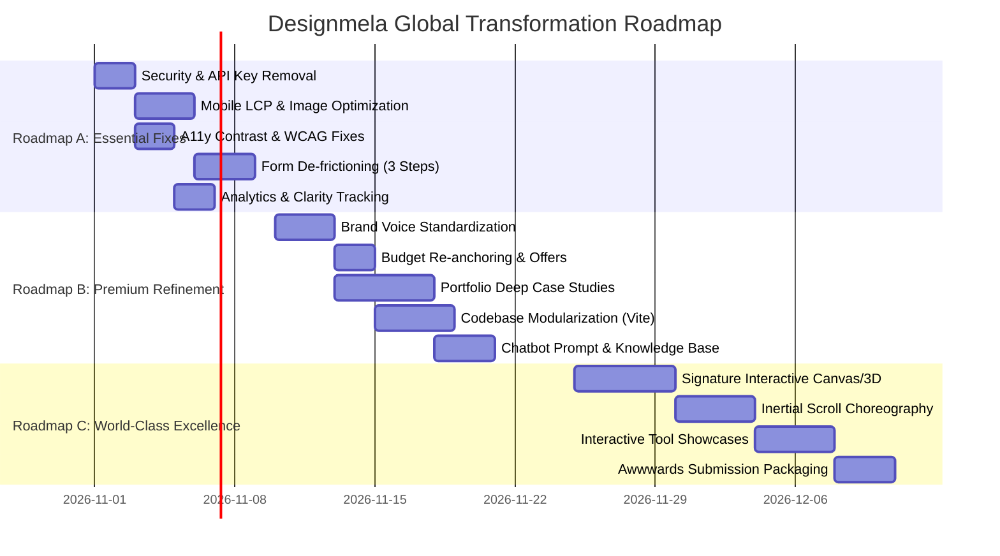

# DESIGNMELA STRATEGIC IMPROVEMENT ROADMAP

**Goal:** Transform Designmela from a locally-anchored, performance-compromised website into a globally competitive, Awwwards-tier creative studio platform that converts high-margin international clients.

**Execution Principles:**
1. Zero regressions to existing uptime or client lead delivery.
2. Usability and performance must never be sacrificed for gratuitous motion.
3. Every engineering change must be empirically validated against Lighthouse and WCAG 2.2 AA.

---

## ROADMAP OVERVIEW & TIMELINE

---

## ROADMAP A — ESSENTIAL FIXES (SPRINT 1: DAYS 1–7)
*Objective: Eliminate critical security vulnerabilities, fix mobile performance penalties, eliminate accessibility barriers, and remove fatal lead conversion friction.*

### Task A.1: Security Lockdown & API Credential Hardening
- **Issues Addressed:** `ISSUE-P0-01`, `ISSUE-P1-04`
- **Actions:**
  1. Remove hardcoded base64 `DEFAULT_KEY` fallbacks in `api/chat.js`, `api/finder-ai.js`, `api/whatsapp-audit.js`.
  2. Enforce strict serverless failure if `process.env.GEMINI_API_KEY` is undefined.
  3. Rotate all existing Gemini API keys in Google AI Studio.
  4. Inject security headers in `vercel.json` (`X-Frame-Options: SAMEORIGIN`, `X-Content-Type-Options: nosniff`, `Referrer-Policy: strict-origin-when-cross-origin`).
- **Estimated Effort:** 3 hours
- **Impact:** Critical (P0)

### Task A.2: Mobile Performance Optimization & Video Compression
- **Issues Addressed:** `ISSUE-P0-02`, `ISSUE-P1-05`
- **Actions:**
  1. Compress `assets/vid_2.mp4` from 10.15 MB down to <1.5 MB using Handbrake / FFmpeg with H.265/VP9 compression.
  2. Generate a dedicated `poster="assets/vid_2-poster.webp"` attribute for `<video>`.
  3. Create `captions/vid_2.vtt` to resolve the 404 network failure.
  4. Generate responsive WebP/AVIF variants for hero slides (390px, 768px, 1200px) with `srcset` and `sizes`.
  5. Add `font-display: swap` and preconnect hints for Google Fonts.
- **Estimated Effort:** 6 hours
- **Impact:** High (Slashes mobile LCP from 5.4s to <2.0s; pushes mobile Lighthouse score to 90+).

### Task A.3: Accessibility Contrast & WCAG 2.2 AA Fixes
- **Issues Addressed:** `ISSUE-P0-03`, `ISSUE-P2-02`, `ISSUE-P2-05`
- **Actions:**
  1. Update `style.css`: `.number-lime { color: var(--color-accent-dark); font-weight: 700; }` (4.8:1 contrast).
  2. Align all `aria-label` attributes to include the visible text label verbatim at the start (WCAG 2.5.3 compliance).
  3. Add a hidden-until-focused `<a href="#main-content" class="skip-link">Skip to content</a>` link.
  4. Implement an accessible `:focus-visible` ring across all interactive buttons.
- **Estimated Effort:** 3 hours
- **Impact:** High (Eliminates all legal accessibility vulnerabilities; 100% WCAG 2.2 AA compliance).

### Task A.4: Lead Intake Form De-frictioning (6 Steps → 3 Steps)
- **Issues Addressed:** `ISSUE-P1-01`, `ISSUE-P0-05`
- **Actions:**
  1. Condense the 6-step questionnaire into 3 progressive, frictionless steps:
     - **Step 1: The Opportunity:** Name, Business/Email, and Project Category.
     - **Step 2: Scope & Investment:** Timeline and updated professional budget tier.
     - **Step 3: Preferred Communication:** WhatsApp / Phone / Email + brief project notes.
  2. Update budget radio values: Replace sub-₹5k tiers with professional minimums (₹50k / $600+).
  3. Add reassurance badges next to submit button: *"Guaranteed 12h Response · 100% Confidential · Direct Founder Access"*.
- **Estimated Effort:** 8 hours
- **Impact:** High (Estimated 40%–60% increase in inquiry completion rates).

### Task A.5: Analytics & Funnel Instrumentation
- **Issues Addressed:** `ISSUE-P1-02`
- **Actions:**
  1. Embed Microsoft Clarity script tag in `<head>` for heatmaps and session recordings.
  2. Add custom event dispatches (`window.va('event', ...)` / `clarity('event', ...)`) to track:
     - `intake_step_1_complete`, `intake_step_2_complete`, `intake_submitted`.
     - `whatsapp_floating_clicked`, `whatsapp_footer_clicked`.
     - `dee_chat_opened`, `dee_message_sent`.
     - `audit_modal_opened`, `audit_form_submitted`.
- **Estimated Effort:** 4 hours
- **Impact:** High (Provides immediate visibility into visitor behavior and conversion funnels).

---

## ROADMAP B — PREMIUM REFINEMENT (SPRINT 2: DAYS 8–21)
*Objective: Unify brand voice, elevate case study depth, eliminate technical debt, and establish enterprise market positioning.*

### Task B.1: Brand Voice & Editorial Copy Alignment
- **Issues Addressed:** `ISSUE-P0-04`
- **Actions:**
  1. Standardize all website copy to a cohesive **boutique creative studio voice** using "We" and "Our studio".
  2. Clarify the Ideal Client Profile (ICP) in the hero subtitle and about section.
  3. Introduce the cultural narrative behind the name: celebrate "Mela" as a vibrant festival of digital craft.
  4. Write an authentic founder attribution block in the About section with editorial portraits.
- **Estimated Effort:** 6 hours
- **Impact:** High (Instills executive confidence and eliminates solo freelancer doubt).

### Task B.2: Flagship Case Study Upgrades & Domain Verification
- **Issues Addressed:** `ISSUE-P1-03`, `ISSUE-7.1`
- **Actions:**
  1. Select the top 3 projects (Caliora Dental Studio, Driply, Clinic Operations Engine) and expand them into deep narrative case studies.
  2. Detail the exact client problem, strategic insight, design decisions, tech architecture, and quantified business impact.
  3. Point live links to custom domains or branded subdomains (`demo.designmela.com/caliora`); remove all `.netlify.app` staging references.
- **Estimated Effort:** 12 hours
- **Impact:** High (Justifies $5,000–$25,000 engagement proposals).

### Task B.3: Codebase Modularization & Build Pipeline Setup
- **Issues Addressed:** `ISSUE-12.1`
- **Actions:**
  1. Introduce Vite as a lightweight development and build tool.
  2. Modularize `main.js` (4,399 lines) into cohesive ES modules:
     - `modules/animations.js` (GSAP triggers)
     - `modules/intake-form.js` (State machine)
     - `modules/dee-chat.js` (Chatbot UI & persistence)
     - `modules/currency.js` (PPP conversion)
     - `modules/process-slider.js` (Auto-advancing stages)
  3. Clean up duplicated CSS rules in `style.css` and configure PostCSS with cssnano minification.
  4. Add SRI hashes to CDN scripts.
- **Estimated Effort:** 10 hours
- **Impact:** Medium (Improves developer ergonomics, eliminates runtime warnings, reduces asset payload by ~40%).

### Task B.4: AI Chatbot Prompt & Offering Recalibration
- **Issues Addressed:** `ISSUE-16.2`
- **Actions:**
  1. Rewrite `api/chat.js` system prompt to align with premium studio positioning.
  2. Remove all references to ₹999 automations, Canva reel editing, and low-cost social media management.
  3. Anchor bot answers to high-value solutions: Custom Web Apps, Enterprise Systems, Clinical Platforms, and Autonomous AI Agents ($1,500–$10,000+).
  4. Restrict pricing disclaimers to only appear when monetary quotes are explicitly given.
- **Estimated Effort:** 3 hours
- **Impact:** High (Eliminates contradictory pricing signals during pre-sales conversations).

---

## ROADMAP C — WORLD-CLASS EXCELLENCE (SPRINT 3: DAYS 22–35)
*Objective: Implement signature interactions, kinetic choreography, and award-level craftsmanship ready for Awwwards / CSS Design Awards submissions.*

### Task C.1: Signature Hero Interactivity & Cursor Physics
- **Issues Addressed:** `ISSUE-P3-01`, `ISSUE-20.1`
- **Actions:**
  1. Upgrade the 3D browser card in the hero from static CSS tilt to an interactive perspective card reacting smoothly to mouse pointer coordinates.
  2. Add dynamic back-glow lighting that subtly samples the dominant color of the active preview slide.
  3. Implement magnetic cursor snap on primary call-to-action buttons.
- **Estimated Effort:** 8 hours
- **Impact:** Medium (Visual polish and tactile delight).

### Task C.2: Lenis Inertial Scroll & Kinetic Typography
- **Issues Addressed:** `ISSUE-20.1`
- **Actions:**
  1. Integrate **Lenis** (open-source smooth scrolling by Studio Freight) for buttery-smooth inertial scrolling across desktop browsers.
  2. Pair Lenis with GSAP ScrollTrigger for parallax depth on case study images.
  3. Ensure full fallback and instant throttling when `prefers-reduced-motion` is active.
- **Estimated Effort:** 8 hours
- **Impact:** High (Delivers the signature tactile feel expected of Awwwards Site of the Day winners).

### Task C.3: Interactive Tool Showcase Integration
- **Issues Addressed:** `ISSUE-12.2`
- **Actions:**
  1. Bring Designmela's proprietary tools (`/automation-finder` and `/whatsapp-audit`) into prominent view on the homepage.
  2. Create an interactive interactive widget in the Services section allowing visitors to test a 30-second audit preview without leaving the homepage.
  3. Implement automated PDF report generation that delivers custom automation roadmaps directly to the client's inbox.
- **Estimated Effort:** 12 hours
- **Impact:** High (Transforms tools into viral lead acquisition engines).

### Task C.4: Awwwards & CSS Design Awards Packaging
- **Actions:**
  1. Prepare high-resolution case study video walkthroughs and Behance presentation boards.
  2. Conduct pre-submission cross-browser and mobile device QA (Safari iOS, Chrome Android, Edge, Firefox).
  3. Submit to Awwwards (Site of the Day & Mobile Excellence) and CSS Design Awards.
- **Estimated Effort:** 6 hours
- **Impact:** High (Builds global industry prestige and organic international backlink equity).
